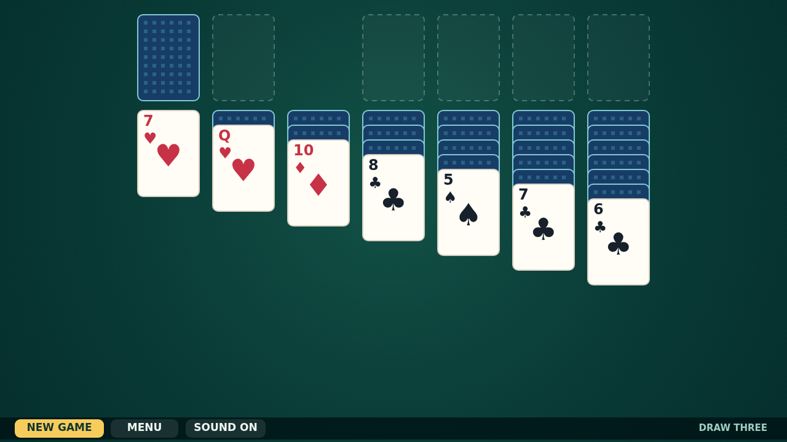

# Cascade

Cascade is classic Draw Three Klondike on a deep green felt table. Turn the stock, uncover the tableau, and weave descending runs in alternating colors until every Ace can begin its journey home.

Cards move naturally by mouse or touch, while a double-click sends an available card straight to its foundation. Clear, generous cards and subtle sound make the game easy to settle into.

The calm breaks beautifully at the finish: all fifty-two cards launch from the foundations, bounce across the floor, and paint a jubilant trail over the table.

